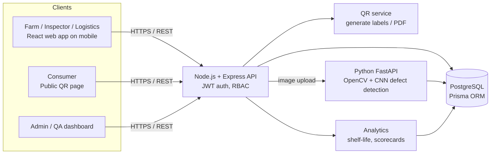
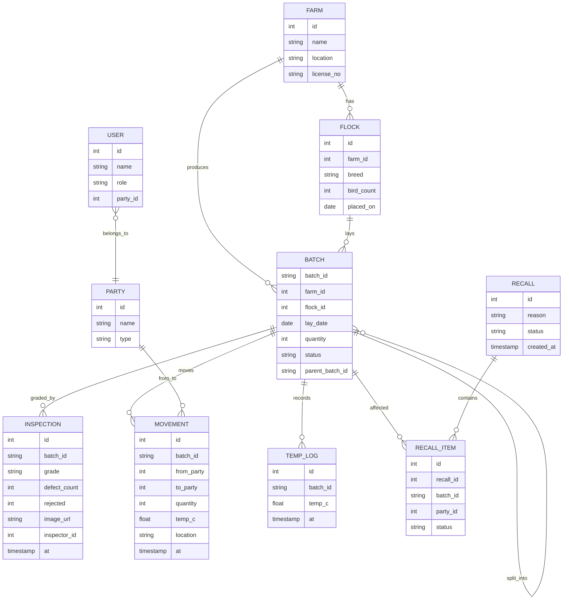
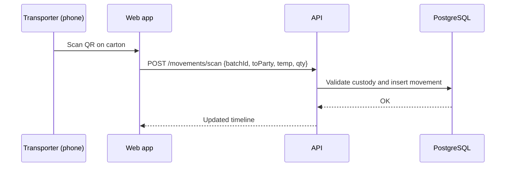

# 6. Initial Prototype / Solution Design

**Project:** EggTrace AI: Egg Batch Traceability and Quality Record Management
**Team:** Code Warriors

---

## 6.1 System Architecture



## 6.2 Data Model (ER Diagram)



`PARTY.type` is one of: farm, collection_centre, warehouse, transporter, buyer.

## 6.3 Key API Endpoints

| Method | Endpoint | Purpose |
|---|---|---|
| POST | `/api/auth/login` | Login (JWT) |
| POST | `/api/batches` | Create batch and generate QR |
| GET | `/api/batches/:id` | Batch details and full timeline |
| GET | `/api/batches/:id/label` | Printable QR label (PDF) |
| POST | `/api/batches/:id/split` | Split a batch into child batches |
| POST | `/api/inspections` | Add inspection and grading |
| POST | `/api/movements/scan` | Record a handover via QR scan |
| GET | `/api/search?q=&destination=&from=&to=` | Search batches |
| POST | `/api/recalls` | Start a recall, returning all affected buyers |
| GET | `/t/:batchId` | Public consumer page |
| POST | `/api/cv/analyze` | (Phase 2) Image defect analysis |
| GET | `/api/suppliers/scorecard` | (Phase 2) Supplier scores |

## 6.4 Recall Trace Query

```sql
WITH RECURSIVE tree AS (
  SELECT batch_id FROM batch WHERE batch_id = $1
  UNION
  SELECT b.batch_id FROM batch b JOIN tree t ON b.parent_batch_id = t.batch_id
)
SELECT DISTINCT p.name, p.type, m.quantity, m.at
FROM movement m
JOIN tree t ON m.batch_id = t.batch_id
JOIN party p ON p.id = m.to_party
WHERE p.type = 'buyer';
```

## 6.5 Handover Sequence



## 6.6 UI Screens (Prototype)

1. **Login**: role-based.
2. **Dashboard**: active batches, recent inspections, open recalls, alerts.
3. **Create Batch**: farm, flock, date, quantity, then the QR label is shown and can be printed.
4. **Scan Handover**: camera scanner, then confirm the receiving party, quantity and temperature.
5. **Batch Details**: timeline (farm, centre, warehouse, transporter, buyer), inspections, temperature chart.
6. **Inspection Form**: grade, defects, photo upload.
7. **Search and Recall**: search filters, a "Trace and Recall" button, and the list of affected buyers.
8. **Consumer Page** (public): farm, packing date, grade, freshness badge, journey map.
9. **Supplier Scorecard** (Phase 2): ranking table and charts.

## 6.7 Project Structure

```
eggtrace-ai/
├── docs/            # submission documents
├── client/          # React (Vite) frontend
├── server/          # Node.js + Express API, Prisma schema
└── cv-service/      # Python FastAPI + OpenCV (Phase 2)
```

## 6.8 Security Considerations

- JWT authentication with role-based access control.
- Public consumer page shows only non-sensitive fields.
- Movement records are append-only (audit trail), and custody is validated before a transfer.
- Input validation and parameterised queries (Prisma) prevent injection.
